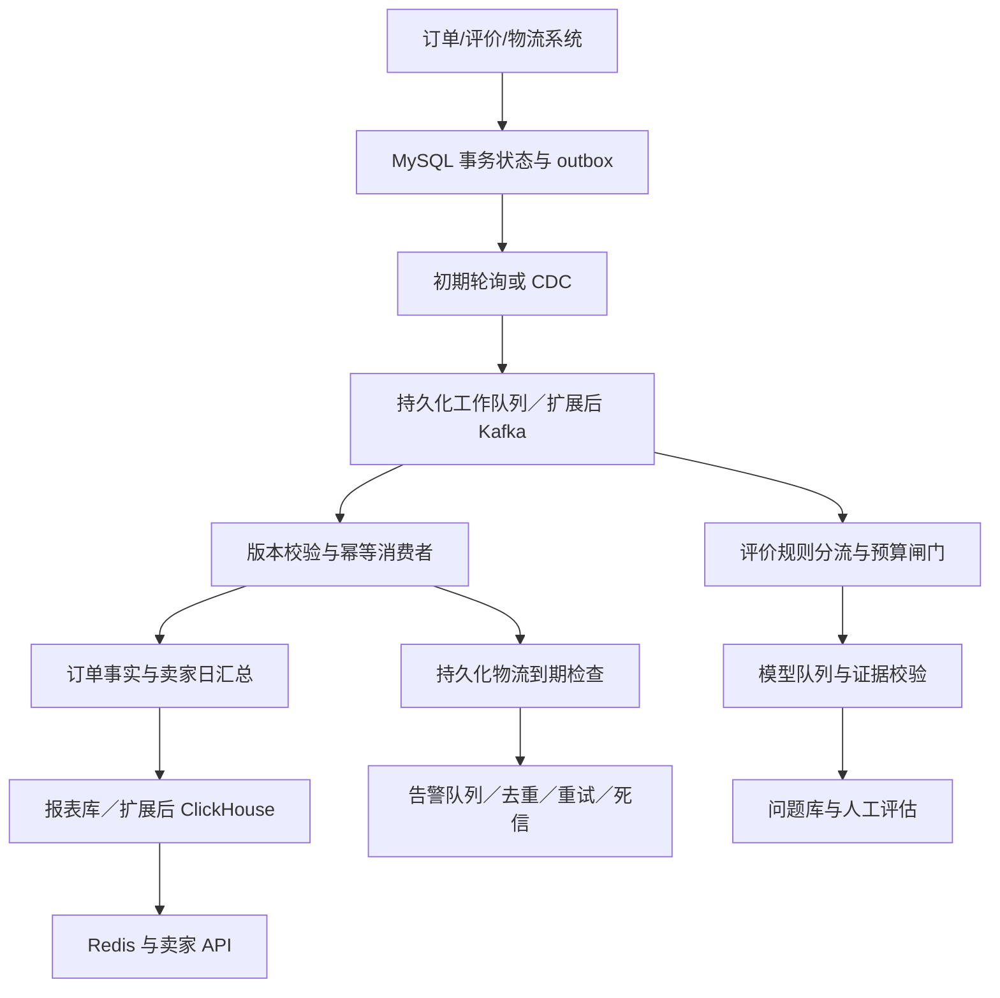

# 卖家实时订单、评价与物流管道设计

## 设计正文

现有 CSV 不能产生实时变更，首先需要订单、评价、物流系统提供事件或接入事务数据库。业务写入与 outbox 事件在同一 MySQL 事务提交，避免订单成功而消息丢失；事件包含 event_id、订单/卖家、版本、发生与接收时间。当前只是设计，未部署、压测，也没有把目标延迟写成已实现性能。

十万订单/天平均约 1.16 单/秒，百万约 11.57 单/秒。假设峰值二十倍、每单六条事件，后者约 1389 事件/秒；这是容量情景，须以真实峰值校正。初期可用 outbox 轮询与持久化工作队列，减少常驻组件；需要多消费者、长期回放或积压增长时，再引入 CDC/Kafka，不能只按订单日量决定堆叠流计算框架。

MySQL 保存交易状态、版本和幂等记录；队列保存可重放事件，消费者处理失败才延后重试。报表从订单当前事实派生卖家日汇总，独立报表库或只读副本承载查询；更大规模评估 ClickHouse 按时间分区、卖家/日期排序，保留重建能力。Redis 缓存卖家最近一百八十天的汇总曲线，缓存键包含租户与汇总版本，读写均校验卖家权限。目标查询 p95 小于一百毫秒，需通过并发及失效场景验证。

订单三十秒目标分配为采集五秒、排队五秒、处理十秒、缓存/API 五秒，留五秒余量。端到端按源提交时间测量，服务统一 UTC 并监控时钟偏差，监控各段积压与 p95/p99。采用至少一次传播：按事件 ID 幂等、按订单版本拒绝旧状态，不能只靠消息顺序或数据库异步合并宣称端到端恰好一次。汇总更新失败可按订单事实重算。

评价先去重、识别空文本/简单情绪、检查可用原文，再将复杂问题送入独立模型队列。低分不等于存在可归因问题，不强制编造类别。模型输出验证结构、枚举和原文证据子串；无支持的内容拒绝，译文与业务归因另评估。一分钟目标预留采集五秒、排队十秒、推理三十五秒、校验入库十秒；超时标记待处理，不能伪称成功满足时限。

物流异常需要持久化到期检查任务，即使没有新物流事件，也在预计送达时间后复查当前订单。送达或取消事件更新检查版本；报警使用订单、异常类型、版本组合去重。通知通过独立队列限流、重试及死信，避免积压阻塞订单展示；恢复后复核状态，防止补发已经失效的告警。

成本按公式而非模型名称估算。假设百万订单/天、三成有评价、每次输入六百及输出一百五十 token，输入/输出每百万 token 单价为 p、q，全年为 65700p+16425q 美元。仅作压力情景取 p=1、q=3，全部评价调用约 114975 美元/年；分流后仅一成调用、缓存再命中两成约 9198 美元/年。十万规模为十分之一；这些单价是假设而非厂商报价，也未包含队列、存储或人工成本。上线须用实际 usage、失败重试和版本化价格替换。

三个首要风险：重复/乱序通过事件幂等、版本校验及回放对账处理；突发积压通过隔离队列、背压和持久化检查点处理，必要时先保证订单状态、暂停模型扩展；模型费用与错误归因通过调用前预算预留、每日/卖家配额、真实用量扣账和证据核查处理，超额排队或退回规则状态。最终验收需覆盖峰值、断连重放、缓存过期、模型限流及“没有新消息但已超时”场景；架构推演不代替这些实测。

## 架构图

## 计算口径及验收边界

正文长度以“设计正文”至“架构图”之间的非空白字符统计，图和参考不计；数字与英文组件名计入字符。成本参数均为情景假设，无真实模型花费、吞吐或时延数据。本设计需结合 Q4 的服务可用性和真实计费继续校准；尚无独立人员审核。

参考：[Debezium outbox 模式](https://debezium.io/documentation/reference/stable/transformations/outbox-event-router.html)；[ClickHouse 增量物化视图](https://clickhouse.com/blog/common-getting-started-issues-with-clickhouse)。物化视图是写入触发的聚合机制，不自动等于业务去重和正确回放。
